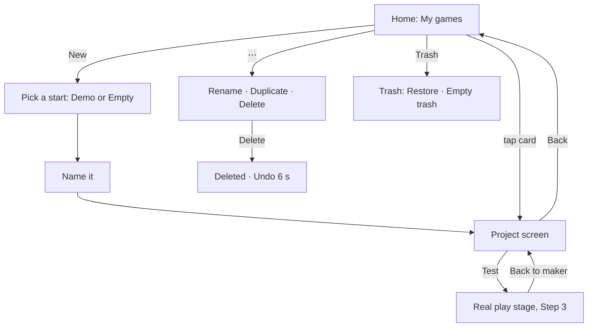

# MS-01 Home and projects (Editor & UX Designer, 2026-11-18)

Feeds builder Step 2 (`docs/maker/steps/step-02-home-save-load.md`) and Step 3 (`step-03-test.md`). Save rules come from DSK, project-format §11.2 and §2. The base phone is 390×844 CSS (S21 Ultra, Red Magic 9 Pro), in the r62 look.

## 1. Purpose and keep/drop
The maker's front door: see my games, make one, open one, test it. One game is one project folder.
- **Keep from ui-shell:**
  - The r70 Home copy and order.
  - The r71 globe's **List view**, which is the reduced-motion and accessible layout.
  - The device-local `homeLast` pref.
  - 48 px targets.
  - A one-line description under each item.
- **Defer:** the 🌎 globe launcher (r71) and its other options (Standalone engine, Make assets, Export project, Social). They come back in a later MS once those tools exist. Step 2 ships the list only.
- **Drop:** localStorage project storage and the shell's 001–003 migrations. Step 1's reader replaces them.

## 2. Flow

Deep links: `#home`, `#project/<projectId>`, `#trash`.

## 3. Controls
| Control | Basic/Adv | Default | Reads / writes | Validation and words |
|---|---|---|---|---|
| **New project** card (first, accent) | Basic | none | Creates `tileengine/projects/<newId>/` from `data/templates/<tpl>.tileproj/` | none |
| Start picker: **Demo**, **Empty** | Basic | Demo | The template folder (data, never code) | none |
| Name field | Basic | "My game" | `project.json` `project.name` | 1–40 code points, trimmed. Empty shows "Give your game a name". |
| Project card | Basic | none | Reads `project.name`, `project.updatedAt`, `stages.length` and the report | Badges: **Newer version** (readOnly) and **Needs fixing (N)** (hard rows) |
| ⋯ **Rename** | Basic | The current name | `project.name`, using the save rules | Same as the Name field |
| ⋯ **Duplicate** | Basic | "X copy" | A new folder with a new `project.id` and `copiedFrom {projectId, rev, at}`. Inner ids are kept. | none |
| ⋯ **Delete** | Basic | none | Moves the folder to `.deleted/<projectId>/` | No confirm step; an Undo toast shows for 6 s |
| **Trash** link (bottom of the list, only when trash isn't empty) | Basic | none | Lists `.deleted/` | **Empty trash** asks once, with a danger button |
| Project screen **Save** | Basic | none | The save rules. A dot shows when there are unsaved changes. | Disabled on readOnly, with the reason |
| Project screen **Test** | Basic | none | Step 3 | A blocked sheet lists the hard rows in words |

## 4. Phone layout
- A 56 px top bar. Its title is "My games" on Home, or the project name on the project screen. Back sits on the left and Save on the right.
- Cards are full width and 72 px tall. The name is 16 px bold, with "Edited 2 min ago · 1 stage" at 14 px. A 48×48 ⋯ button sits on the right.
- The New project card is always first, and on first open it's never scrolled out of view.
- The project screen shows the name, the stage count and a big **Test** button in the thumb zone (bottom third), with Back top-left.
- Toasts sit above the safe area and never cover the Test button.

## 5. States
- **Empty:** one big New project card, plus "Your games live on this device."
- **Loading:** card skeletons. The screen is never blank for more than 300 ms.
- **Unsaved:** a dot on Save. Autosave runs after each change and on `visibilitychange`.
- **Save failed** (typed error). The banner stays until it's dismissed or the next save works.
  - `writeFailed`: "Couldn't save <file>. Your phone may be full. Your last save is safe."
  - `staleRev`: "This game changed somewhere else. Reopen it to see the latest."
  - `readOnly`: "Made with a newer TileEngine. Update the app to open it."
- **Unreadable project:** the card shows "Can't open: <reason>". Its ⋯ menu still offers Duplicate (if the project is readable) and Delete.

## 6. Engine and data calls
- `readProject` (Step 1), for every open and every list badge.
- The save plan in `src/editor/project/save.ts`.
- Nothing else, and no rules code.

## 7. Acceptance checks (both phones)
1. First run: the empty state shows. New, Demo, a name, and you're on the project screen in 3 taps plus typing.
2. Kill the app and reopen: the project is listed and opens identical (`readProject` deep-equal).
3. Rename, then Duplicate: "X copy" appears, and the original is unchanged byte for byte.
4. Delete then Undo within 6 s restores it. Delete, then Trash, then Restore also restores it.
5. Fill the storage (test hook): Save shows `writeFailed` with the file name, and the last save still opens.
6. A v7 project shows **Newer version**. Save and Test are disabled, each with the reason, and there is no demo fallback.
7. Every target is 48 px or more and passes AA contrast in light and dark.

## 8. Out of scope
- The globe launcher.
- The wizard (MS-02) and the stage editor (MS-03).
- Cloud sync, import and export.
- Map thumbnails (a plain colour block for now).

## 9. Shell reference (behaviour only, never code)
- `ui-shell/screenshots/01-home.png` and `24-project-settings.png` (these will be under `docs/maker/shots/`).
- `docs/maker/ux/home-globe-plan.md`, List view section.
- `docs/maker/ux/design-notes/home-globe.md`.
