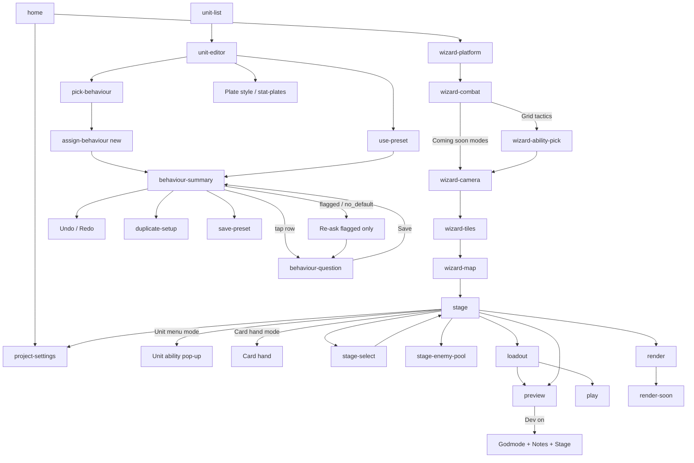

# TileEngine — Screen map (UI shell)

**Owner:** Editor & UX Designer  
**Builds on:** `ux/new-project-wizard.md`  
**Prototype:** `ui-shell/` (clickable, no game logic)  
**Look:** Locked to the existing shell (colours, type, spacing, components).

---

## Audiences (same as wizard)

RaiKynn, players and indie devs all use the **engine** and the **Stage/Level Designer**. There is no in-game level maker in exported games (CEO S1).

## Screens

| ID | Screen | Notes |
|---|---|---|
| `home` | Home / entry | New project, open settings |
| `wizard-platform` … `wizard-map` | New Project wizard | Grid tactics Live; after Combat → **wizard-ability-pick** (Unit menu default / Card hand). Turn RPG / RTS Coming soon (skips ability-pick). |
| `wizard-ability-pick` | Ability presentation | Unit menu (default) vs Card hand; Grid tactics only |
| `stage` | Stage editor | Blank white grid + unit pop-up / card-hand mocks |
| `project-settings` | Project settings | Edit ability presentation (and later more) |
| `stage-select` | Stage select | Add / rename / reorder / duplicate stages |
| `stage-enemy-pool` | Enemy pool | Per-stage enemy toggles + optional weights |
| `loadout` | Loadout | Pick units before Play/Preview |
| `preview` | Preview | Placeholder + Dev toggle → Notes, Stage, Godmode sliders |
| `render` / `render-soon` | Render | Browser (itch.io) or Mobile → coming soon |
| `place-unit` | Place unit | Tap empty cell |
| `unit-list` | Unit list | Select / Edit / Behaviour / Delete |
| `unit-editor` | Unit editor | Stats + behaviour setups + **Plate style Coming soon** |
| `pick-behaviour` | Pick a behaviour | Searchable; day-one starters first |
| `assign-behaviour` | New questionnaire | Full knobs for a new setup |
| `behaviour-summary` | Setup summary | Every answer; tap row to edit one; Undo / Duplicate / Save preset |
| `behaviour-question` | Single answer | Jump-edit + Reset to default |
| `duplicate-setup` | Duplicate | Same unit or another unit |
| `save-preset` | Save preset | Named preset → localStorage |
| `use-preset` | Use a preset | Apply preset to current unit |
| `sprite-upload` | Sprite upload | File + preview |
| `play` | Play | Toast placeholder |

### Plate style (unit editor)

Locked placeholder. Naming from live game plates in `/workspace/g-tile-engine/src` (stamp 2026-11-03, read-only for names): health plate (`tile-hp`), ward (`tile-hp-ward`), stand (`tile-hp-stand`), damage/attack (`tile-dmg`), venom damage (`tile-dmg-venom`). Buff/debuff colour reactions (ward blue, stand gold, venom purple) pending Librarian catalogue — **Coming soon**.

---

## Behaviour flow

Catalogue snapshot: `ui-shell/data/behaviours.json` (from Behaviour Librarian).

**Edit without redo:** Summary lists each question + value (`default` marker if unchanged). Tap one row → edit only that knob → Save returns to summary. **Reset to default** is per-knob. **Undo** restores last snapshot. **Invalidation:** banned/dependent answers get amber **Needs a new answer**; Fix flagged walks only those. Never wipe the rest.

---

## Deep links

`#home`, `#wizard-*` (incl. `#wizard-ability-pick`), `#stage`, `#project-settings`, `#preview`, `#render`, `#render-soon`, `#place-unit`, `#unit-list`, `#unit-editor`, `#pick-behaviour`, `#assign-behaviour`, `#behaviour-summary`, `#behaviour-question`, `#duplicate-setup`, `#save-preset`, `#use-preset`, `#update-preset`, `#sprite-upload`, `#play`

## Ability presentation (CEO 2026-11-09)

Cards are **not** the default. Default = **Unit menu**.

| Mode | Stage mock |
|---|---|
| Unit menu | Pop-up anchored to tapped unit; Attack / Spells / Items; 48px rows; tap-outside closes |
| Card hand | Bottom fan/row of cards; tappable; clears thumb-bar space |

Choice set in wizard (after Combat, Grid tactics only) and editable in **Project settings**.

## Catalogue rev 5

- `ability-presentation.style` is `required` + `ask_in_wizard` — wizard step always shown; Default = Unit action menu, still must pass through.
- Behaviour-level `active_when` hides card-only behaviours from Pick when unit action menu is selected.
- `renamed_from` migrations on load (setup-format §8.2). `card-recursion` → `ability-refresh`.
